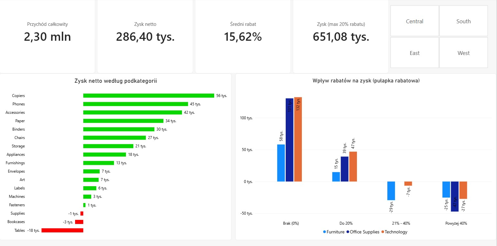
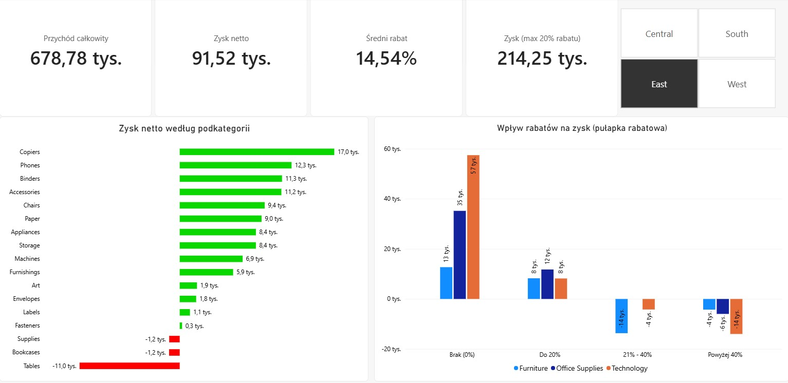

# Analiza sprzedaży i rentowności (Superstore)

Kompleksowa analiza bazy zamówień detalicznych (**9 994 rekordy**) przeprowadzona w pełnym procesie analitycznym (**SQL → Excel / Power Query → Power BI**), mająca na celu identyfikację źródeł zysku oraz obszarów utraty marży wynikających z polityki rabatowej.

**Narzędzia i technologie:** MySQL (phpMyAdmin), Excel (Power Query), Power BI Desktop (Power Query, kolumny obliczeniowe, modelowanie danych, analiza scenariuszowa)

---

## Kluczowe wnioski biznesowe

* **Próg opłacalności rabatów (pułapka rabatowa):** Zamówienia z rabatem do **20%** pozostają rentowne we wszystkich kategoriach produktowych. Przekroczenie progu 20% (przedziały 21%–40% oraz powyżej 40%) powoduje spadek łącznego wyniku poniżej zera.
* **Wpływ ograniczenia rabatów (scenariusz max 20%):** Przeliczenie rentowności zamówień przy założeniu maksymalnego rabatu na poziomie **20%** (przy zachowaniu wolumenu sprzedaży) podnosi całkowity zysk netto firmy z **286,40 tys.** do **651,08 tys.** (+127%).
* **Straty na poziomie podkategorii:** Mimo wysokich obrotów największe straty generują podkategorie **Tables** (-18 tys.), **Bookcases** (-3 tys.) oraz **Supplies** (-1 tys.).
* **Pułapka średniej w Binders:** Na poziomie zagregowanym podkategoria *Binders* wygląda rentownie przy średnim rabacie ~37%. Rozbicie na progi rabatowe ujawnia jednak, że zysk pochodzi wyłącznie z transakcji 0–20%, natomiast wyprzedaże na poziomie 70–80% zjadają ponad połowę potencjalnego zysku tego działu.

---

## Dashboard Power BI

### Widok ogólny (cała firma)

### Analiza regionalna (przykład filtrowania – region West)

---

## Struktura repozytorium

* `superstore_analiza_wlasciwa.sql` – zapytania SQL eksplorujące dane, marżowość oraz strukturę rabatów.
* `Superstore_Analiza_Sprzedazy_dla_sql.csv` – oczyszczony zbiór danych wykorzystany w analizie.
* `Superstore_analiza_wizualizacja.pbix` – interaktywny raport Power BI z przekształceniami w Power Query oraz kalkulacjami marży.
